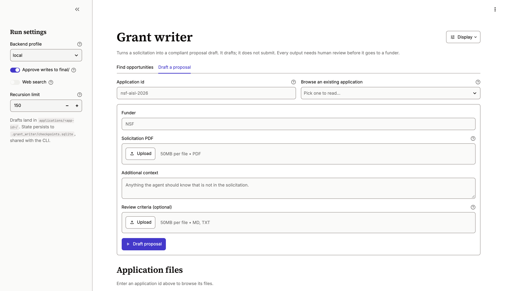
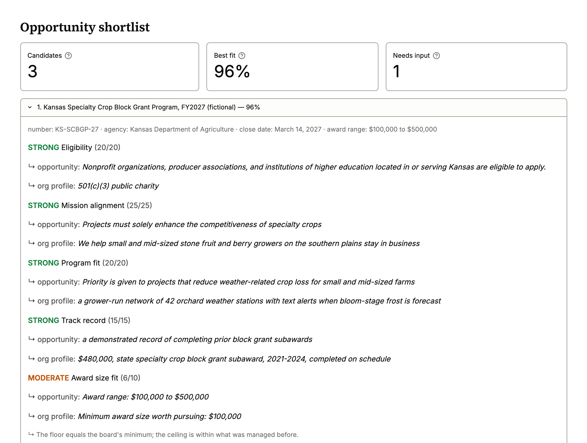
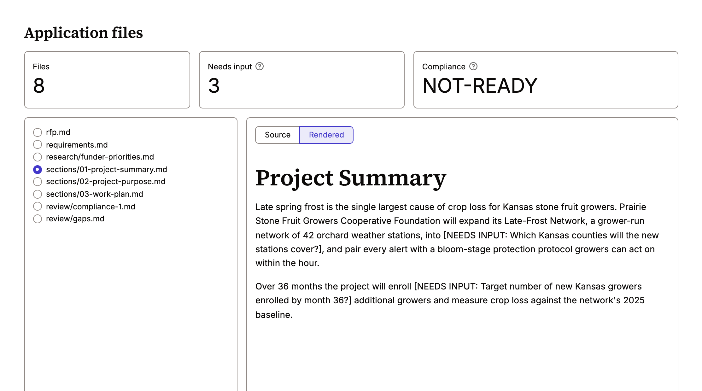
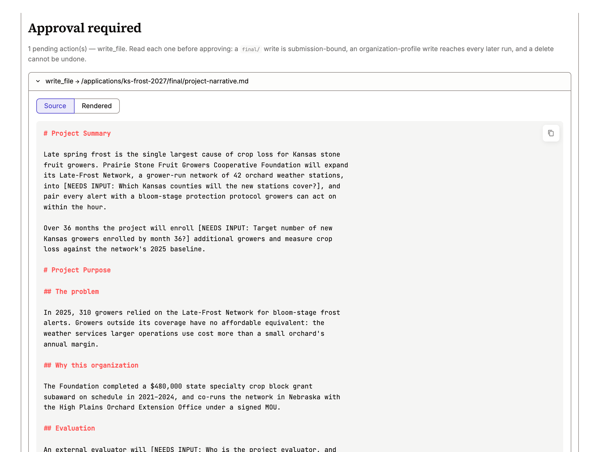

# Grant Writer Agent

[](https://github.com/darylalim/grant-writer-agent/actions/workflows/ci.yml)

An AI grant-writing agent built on LangChain
[Deep Agents](https://docs.langchain.com/oss/python/deepagents/overview) and Claude.

- **`discover`** finds funding opportunities on grants.gov and the web, then scores how well
  each fits your organization, with a quoted citation for every judgement.
- **`draft`** turns a solicitation into a proposal: it extracts the requirements, researches
  the funder, drafts and audits each section, and assembles the result.

Where a fact is unknown, it writes `[NEEDS INPUT: <question>]` instead of inventing one.

> [!IMPORTANT]
> This drafts proposals; it does not submit them. Every output needs human review before it
> goes to a funder. See [Guardrails](#guardrails).

## Contents

- [Quick start](#quick-start)
- [Usage](#usage)
- [Finding opportunities](#finding-opportunities)
- [Drafting a proposal](#drafting-a-proposal)
- [Web UI](#web-ui)
- [Deploying](#deploying)
- [Architecture](#architecture)
- [Guardrails](#guardrails)
- [Development](#development)

## Quick start

Requires Python 3.13+ and **uv 0.13.4** exactly (`uv self update 0.13.4`); `pyproject.toml`
pins it, so other versions refuse to run.

```bash
uv sync
cp .env.example .env                  # add ANTHROPIC_API_KEY and TAVILY_API_KEY
mkdir -p memories/org && cp templates/org-profile.md memories/org/AGENTS.md
$EDITOR memories/org/AGENTS.md        # describe your organization

# 1. Find opportunities worth applying to
uv run grant-writer discover --scan-id rural-health-2026 --focus "rural health education"

# 2. Draft a proposal
uv run grant-writer draft --app-id nsf-aisl-2026 --rfp ~/Downloads/solicitation.pdf --funder NSF

# 3. Refine it later
uv run grant-writer chat --app-id nsf-aisl-2026
```

The organization profile holds your data, so git ignores it. If you skip the `cp`, the first
run creates it from the template; an existing profile is never overwritten.

> [!WARNING]
> **Upgrading from 0.5.0 or earlier?** Copy `memories/org/AGENTS.md` somewhere safe before
> you pull, then copy it back afterwards. The profile used to be tracked, and the commit that
> untracks it deletes your copy (or, if you edited it, blocks the pull — and `git stash` or
> `git checkout` can discard your edits).

## Usage

### Commands

| Command | What it does |
|---|---|
| `discover --scan-id ID` | Search, triage, and score candidates; print a ranked shortlist |
| `draft --app-id ID` | Extract requirements, research, draft, audit, and assemble |
| `chat --app-id ID` | Resume an application's thread to refine it |
| `db-setup` | Create or migrate the Postgres tables (deployments only) |
| `healthcheck` | Exit 0 when the database answers (readiness probe) |
| `ops-check` | Report runs that need attention as JSON; exit 1 if any |

Only `discover`, `draft`, and `chat` call the model and cost money.

State is saved to `.grant_writer/checkpoints.sqlite`, so rerunning `draft` or `chat` with the
same ID resumes the same plan and history. A scan and an application can share a name; they
are kept on separate threads.

### Flags

Flags go **after** the subcommand: `grant-writer draft --app-id X --approve`.

| Flag | Commands | Effect |
|---|---|---|
| `--focus TEXT` | `discover` | What to search for |
| `--agencies CODES` | `discover` | Pipe-separated grants.gov agency codes, e.g. `USDA\|NSF` |
| `--rfp FILE` | `draft` | Solicitation PDF, extracted to `rfp.md` before the run |
| `--funder NAME` | `draft` | Funder name, e.g. `NSF` |
| `--rubric FILE` | `draft` | Grade the draft against the funder's review criteria and revise |
| `--notes TEXT` | `discover`, `draft` | Extra context for this run |
| `--approve` | all | Pause for approval before writing to `final/` (no effect on `discover`) |
| `--no-search` | all | Skip web search; no `TAVILY_API_KEY` needed |
| `--profile server` | all | Keep drafts in graph state instead of on disk |
| `--recursion-limit N` | all | Max graph steps per turn (default `150`) |
| `--operator` | all | Allow a run while `DATABASE_URL` is set (logged) |

### Configuration

Set these in `.env` (see `.env.example`).

| Variable | Required | Purpose |
|---|---|---|
| `ANTHROPIC_API_KEY` | Yes | Model provider |
| `TAVILY_API_KEY` | Unless `--no-search` | Web search for funder research and non-federal opportunities |
| `LANGSMITH_API_KEY` | Recommended | Tracing; a multi-agent run is hard to debug from stdout alone |
| `GRANT_WRITER_<ROLE>_MODEL` | No | Override a role's model (roles below) |
| `GRANT_WRITER_<ROLE>_EFFORT` | No | Override a role's effort: `low`, `medium`, `high`, `xhigh`, `max` |
| `GRANT_WRITER_ROOT` | No | Project root, when the console script runs outside the repo |

Deployment variables are listed under [Deploying](#deploying).

| Role | Does | Default model | Default effort |
|---|---|---|---|
| `DRAFTING` | Orchestrates a draft; writes sections | Claude Opus 5.5 | `high` |
| `RESEARCH` | Researches the funder | Claude Sonnet 5.5 | `high` |
| `COMPLIANCE` | Reviews drafts against the RFP | Claude Sonnet 5.5 | `high` |
| `GRADER` | Scores a draft against `--rubric` | Claude Opus 5.5 | `high` |
| `DISCOVERY` | Orchestrates a scan; scores candidates | Claude Sonnet 5.5 | `medium` |

Discovery runs at `medium` because a person reads the shortlist before acting on it. Funder
research stays at `high` because every section builds on it, and it is a small share of a
drafting run's cost.

## Finding opportunities

```bash
uv run grant-writer discover --scan-id rural-health-2026 \
    --focus "afterschool STEM in rural districts" --agencies "USDA|NSF"
```

The ranked shortlist prints when the run ends. Files are written to
`opportunities/<scan-id>/`:

| Path | Contents |
|---|---|
| `candidates/` | Full text of each candidate opportunity |
| `scored/` | One fit-scoring file per candidate |

grants.gov needs no API key, so `--no-search` still finds US federal opportunities. Web search
adds private foundations, state agencies, and non-US funders.

### How scoring works

Each candidate is rated on six criteria: eligibility, mission alignment, program fit, track
record, award size fit, and timeline feasibility. Each rating is a verdict word (`STRONG` to
`NONE`) backed by a quoted citation. The weights live in `opportunities.py` and are never shown
to the model, so the fit percentage is computed from the verdicts rather than asserted.

- **Unparseable** candidates show as *unscored*, never 0%.
- **Ineligible** candidates (`NONE` on eligibility) sort below the scored ones but keep their
  score and evidence, so the call can be checked.
- **Citations** are checked against the file they name, ignoring line wrapping, emphasis, and
  case. Any that can't be found are flagged.

## Drafting a proposal

```bash
uv run grant-writer draft --app-id nsf-aisl-2026 \
    --rfp ~/Downloads/solicitation.pdf --funder NSF --rubric criteria.md
```

Files are written to `applications/<app-id>/`:

| Path | Contents |
|---|---|
| `rfp.md` | Extracted solicitation text |
| `requirements.md` | Every required section, limit, review criterion, and deadline, with citations |
| `research/` | Funder priorities, recent awards, and program language |
| `sections/` | One file per narrative section; all revision happens here |
| `review/` | Compliance reports, plus `gaps.md` collecting every `[NEEDS INPUT]` question |
| `final/` | Assembled submission-ready text, written once per file |

With `--rubric`, a grader scores the draft against the funder's published review criteria
each time the agent finishes, and sends it back for revision if it falls short (up to 3
rounds).

## Web UI

An optional Streamlit front end runs both workflows on one page:

```bash
uv run streamlit run streamlit_app.py
```

<picture>
  <source media="(prefers-color-scheme: dark)" srcset="docs/images/landing-dark.png">
  
</picture>

It shares the CLI's checkpoint, so a run started in the browser can continue with
`grant-writer chat`, and the other way round. On top of the CLI it adds:

- **Shortlist detail.** Each candidate's six verdicts and citations, with the source text one
  click away.

  <picture>
    <source media="(prefers-color-scheme: dark)" srcset="docs/images/shortlist-dark.png">
    
  </picture>

- **File browser and gap count.** Each application's files, how many `[NEEDS INPUT]` markers
  remain, and the latest compliance verdict. Source view by default, with a rendered-markdown
  toggle; files in `final/` always open as source, so what you approve is exactly what gets
  written.

  <picture>
    <source media="(prefers-color-scheme: dark)" srcset="docs/images/files-dark.png">
    
  </picture>

- **Approval previews.** The full content of each pending `final/` write, not just its path.
  Approval is on by default.

  <picture>
    <source media="(prefers-color-scheme: dark)" srcset="docs/images/approval-dark.png">
    
  </picture>

Screenshots use a fictional organization and fictional solicitations.

Controls that start a turn are disabled while one is running or waiting for approval, since
starting another would discard the pending write.

The theme follows the system's light or dark mode and meets WCAG AA contrast in both; see
`.streamlit/config.toml`. One known exception: Streamlit draws a focused button's ring at half
opacity (2.5:1 light, 1.8:1 dark), though the button also darkens.

## Deploying

The [web UI](#web-ui) can serve a team. A shared deployment needs sign-in, the `server`
profile, and Postgres.

### Deployment variables

| Variable | Default | Purpose |
|---|---|---|
| `DATABASE_URL` | unset (SQLite) | Postgres for checkpoints, the `Store`, and the run table |
| `GRANT_WRITER_DB_POOL_MAX_SIZE` | `10` | Most Postgres connections per process |
| `GRANT_WRITER_DB_POOL_TIMEOUT` | `30` | Seconds to wait for a free connection |
| `GRANT_WRITER_ALLOWED_DOMAINS` | empty | Comma-separated email domains allowed to sign in, matched exactly |
| `GRANT_WRITER_ALLOWED_EMAILS` | empty | Comma-separated addresses also allowed (outside collaborators) |
| `GRANT_WRITER_DAILY_BUDGET_USD` | `10` | Estimated spend per signed-in user per UTC day |
| `GRANT_WRITER_MAX_CONCURRENT_RUNS` | `3` | Signed-in turns running at once, across the deployment |
| `GRANT_WRITER_SEARCH_COST_USD` | `0.008` | Estimated cost of one web search, counted toward the budget |
| `GRANT_WRITER_TRACING` | `hidden` when shared | LangSmith tracing: `full`, `hidden`, or `off` |

Run `grant-writer db-setup` once per deploy, before the app starts. With `DATABASE_URL` set,
`draft`, `chat`, and `discover` refuse to run without `--operator`, because the CLI has no
sign-in and could reach any user's thread. SQLite history does not migrate to Postgres.

### Sign-in

Add an `[auth]` section to `.streamlit/secrets.toml` to require sign-in through Streamlit's
OIDC support (`st.login`), which works with any OpenID Connect provider:

```toml
[auth]
redirect_uri = "https://your-host/oauth2callback"
cookie_secret = "a long random string"
client_id = "..."
client_secret = "..."
server_metadata_url = "https://your-provider/.well-known/openid-configuration"
```

- **Allowlist.** The provider must report the email as verified, and it must match
  `GRANT_WRITER_ALLOWED_DOMAINS` or `GRANT_WRITER_ALLOWED_EMAILS`. Both empty admits nobody.
  Domains match exactly, so `yourorg.org` doesn't admit `sub.yourorg.org`.
- **Isolation.** Each user gets their own threads and folders, identified by a digest of the
  provider's issuer and subject, never by email.
- **Profile.** Signed-in runs always use the `server` profile.
- **No open deployments.** With `DATABASE_URL` set and no `[auth]`, the app refuses to start.

### Limits

Both are checked before each signed-in turn, including one that resumes an approval.

- **Daily budget per user.** Estimated at list prices; an unknown model is charged at the most
  expensive known rate. A running turn is allowed to finish, and the budget resets at 00:00 UTC.
- **Concurrent turns.** At the limit you're asked to try again shortly, rather than starting a
  run that would fail partway on rate limits.

### What is recorded

None of these records hold proposal content: no messages, file text, organization profile, or
rejection reasons.

| Record | Where | Holds |
|---|---|---|
| Run table | Postgres, or `.grant_writer/runs.sqlite` | Pseudonymous user, thread, time, outcome, tokens, searches, cost, error class |
| Approval record | Same | User, time, thread, file, and decision, written *before* the decision is sent |
| Server logs | JSON lines on stderr | Ids, phase, outcome, and error type |
| LangSmith traces | LangSmith, if enabled | Timing, tokens, errors, and the call tree; inputs, outputs, and metadata hidden by default |

If the approval record can't be written, the approval is refused and can be retried; a
rejection still goes through. Retention is the deployment's policy, and the approval record is
meant to outlive a user's deletion.

### Monitoring

- **Liveness:** Streamlit's `/_stcore/health` endpoint.
- **Readiness:** `grant-writer healthcheck`.
- **Alerts:** run `grant-writer ops-check` on a schedule. It flags failed and declined runs
  above 10% of the last 24 hours, rate-limit and pool-timeout failures, and threads waiting on
  an approval for more than 3 days. Also alert on the `run.limited`, `run.failed`, and
  `approval.unrecorded` log events.

## Architecture

Two agent graphs share one set of infrastructure:

```
discovery (sonnet)        searches grants.gov + web, triages, delegates scoring
└── opportunity-scout     (sonnet, write-limited)  scores one candidate per call

orchestrator (opus)       reads RFP, extracts requirements, plans, delegates, assembles
├── funder-researcher     (sonnet + web search)    what this funder actually rewards
├── section-drafter       (opus + skills)          one section per call
└── compliance-checker    (sonnet, write-limited)  audits drafts, cannot edit them
```

Each subagent works in its own context: research produces search results the drafter doesn't
need, drafting needs the style guides loaded, and compliance judges drafts without seeing the
drafter's reasoning.

### Where state lives

| Path | Lifetime | Purpose |
|---|---|---|
| `memories/org/AGENTS.md` | Permanent, untracked | Organization profile, loaded every turn |
| `templates/org-profile.md` | Tracked | Blank profile template; no agent can write it |
| `skills/*/SKILL.md` | Permanent | Section drafting guides, loaded on demand |
| `opportunities/<scan-id>/` | One scan | Candidate texts and scores |
| `applications/<app-id>/` | One application | RFP, requirements, research, drafts, reviews |
| `.grant_writer/checkpoints.sqlite` | Until deleted | Conversation state, plans, and writes awaiting approval |
| `.grant_writer/runs.sqlite` | Until deleted | Run table for signed-in turns (no content) |

Back up the checkpoint file before upgrading dependencies; it is the one piece of state a
library upgrade can make unreadable. Close the CLI and UI first, and use SQLite's backup rather
than `cp`, which can miss rows still in the write-ahead log:

```bash
sqlite3 .grant_writer/checkpoints.sqlite ".backup .grant_writer/checkpoints.pre-upgrade.sqlite"
```

### Backends

| Profile | Drafts | Skills and memory | Use for |
|---|---|---|---|
| `local` (default) | Files on disk | Files on disk | CLI and local UI |
| `server` | Graph state | `Store` seeded from disk at startup | Web deployments |

Never use `local` inside a web server. Without `DATABASE_URL`, the `server` Store is in memory
and lost when the process exits. On each start, skills are refreshed from disk, but the
organization profile is seeded only when the Store has none, so edits made in the app survive
a restart.

### Permissions

- **Drafting** can write only to `/applications/`, `/memories/`, and `/opportunities/`;
  everything else is read-only. Rules are first-match-wins, so specific allows come before the
  catch-all deny (see `backends.py`).
- **`--approve`** pauses on writes to `/applications/*/final/**` and on any delete under
  `/applications/`. It doesn't pause on every write, because constant prompts get approved
  without being read.
- **Deletes** follow the write rules: the agent can delete a file it can write, and can never
  delete a directory.
- **Discovery** cannot write to `/applications/` and never pauses for approval.
- **The organization profile** is shared by every user on `server`, so there each drafting
  write to it pauses for approval regardless of `--approve`, and discovery can't write it. On
  `local` it stays writable without a pause.
- **The real-disk tool** (`fetch_grants_gov_opportunity`) bypasses these rules, so it limits
  itself to the folder its own graph may write to.
- **Solicitations** are extracted by the CLI or UI before the run, never by the agent: up to
  50 MB and 500 pages, checked by the `%PDF-` signature, in a child process stopped after two
  minutes. The agent has no tool that opens a PDF, and the UI keeps no copy of the upload.

## Guardrails

Invented preliminary data, personnel, or budget figures are misconduct, not just a bad draft.

- **No invented facts.** Unknowns become `[NEEDS INPUT: <question>]` and are collected in
  `review/gaps.md`.
- **Measured lengths.** Word and character counts come from the `measure_text` tool on the
  saved file, never from the model's estimate.
- **Independent review.** The compliance reviewer cannot edit what it reviews.
- **Cited scores.** The scout must cite every verdict; an honest `NONE` beats a hopeful
  `STRONG`.
- **Visible refusals.** A turn declined by the model's safety classifier is shown as declined,
  with the agent and category, not as an empty reply. Health and biomedical topics can trigger
  false refusals; rephrase or retry. There is no automatic fallback model.

Before submitting, check every `[NEEDS INPUT]` marker, every number, and every citation.

## Development

```bash
uv sync                                                    # includes the dev group (streamlit)
uv run pytest tests/ -q                                    # offline, no API calls
uvx ruff@0.17.1 check src/ tests/ evals/ streamlit_app.py
uvx ruff@0.17.1 format --check src/ tests/ evals/ streamlit_app.py
uvx ty@0.0.89 check src/ tests/ evals/ streamlit_app.py    # 1 upstream diagnostic expected
uv run python -m evals.run_scout                           # prompt eval: live model, costs money
```

- **Don't use `--no-dev`.** The Streamlit `AppTest` cases would skip and the type check would
  report extra diagnostics.
- **Tests** cover wiring failures that raise no error, such as a subagent missing its skills or
  a misordered permission rule. See the invariants in `CLAUDE.md`.
- **Postgres tests** are opt-in: set `TEST_DATABASE_URL` to a server where you can create
  databases, then run `uv run pytest tests/ -q -m postgres`. `uv run python -m
  tests.load_postgres` load-tests with a stub model at no cost.
- **Evals** in `evals/` are not part of the suite. Tests can't judge prompt quality, so run the
  evals by hand after editing a prompt. See `evals/README.md`.
- **CI** runs on Python 3.13 and 3.14 with the same pinned `uv`, `ruff`, and `ty` as the local
  Claude Code hooks, runs the Postgres tests in their own job, and audits `uv.lock` with
  `uv audit`.
- **Releases** are automatic: bumping `version` in `pyproject.toml` and pushing green to `main`
  tags the release and publishes the wheel and sdist.

### Known quirks

- The model sees an `execute` tool, but it does nothing on either backend; it returns an error.
  `test_execute_tool_is_not_a_permission_bypass` guards this.
- `RubricMiddleware` is beta upstream; its API may change.

## License

MIT. See [LICENSE](LICENSE).
